# mjlab_hand

[](https://www.python.org/)
[](https://github.com/mujocolab/mjlab)
[](https://github.com/google-deepmind/mujoco)
[](https://github.com/astral-sh/uv)
[](LICENSE)

Dexterous manipulation tasks based on [mjlab](https://github.com/mujocolab/mjlab), providing grasping, in-hand rotation, throwing, reorientation, regrasping, two-hand handover, juggling, plate-spinning and Baoding-ball tasks for `Allegro`, `LEAP`, `Shadow`, `Sharpa`, `Wuji`, and `XHand`. It also includes the implementation of [ContactExplorer](https://arxiv.org/abs/2603.10971), which comprises:

- **Post-contact coverage reward**: rewards novel contacts between hand keypoints and object surface regions.
- **Pre-contact reaching reward**: guides hand keypoints toward under-explored object regions before contact.

## Tasks

Most task ids name the hand, e.g. `Grasp-{Hand}`, where `{Hand}` is one of `Shadow`, `Allegro`, `LEAP`, `Sharpa`, `Wuji`, or `XHand` (`Sharpa-Right` for grasping and in-hand rotation); `uv run list-envs` prints every id. The clips show one hand per task.

### Manipulation

<table>
  <tr>
    <td width="25%" align="center">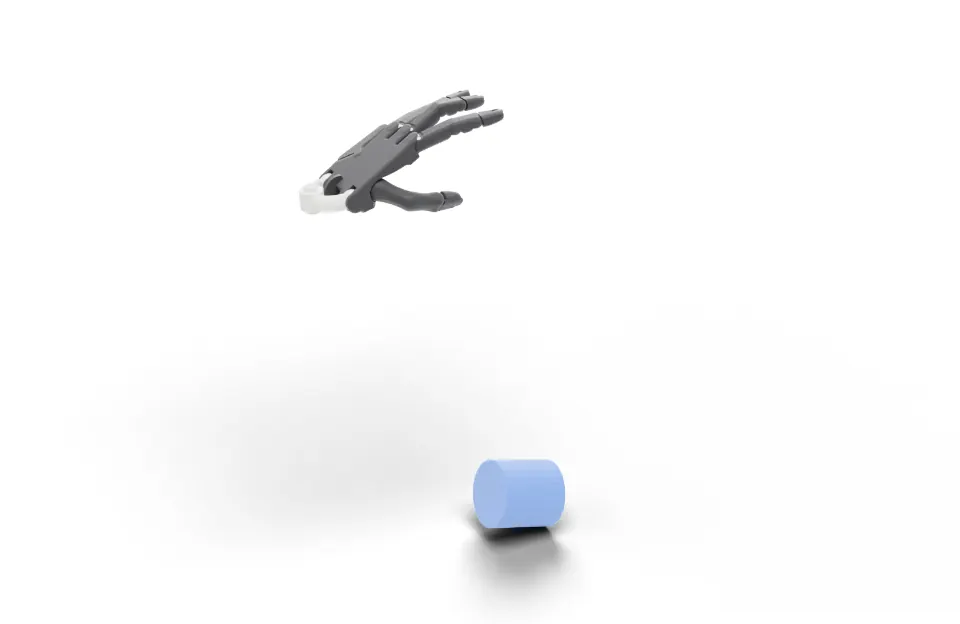<br><b>Grasp</b> · Shadow<br><sub><code>Grasp-Shadow</code></sub></td>
    <td width="25%" align="center">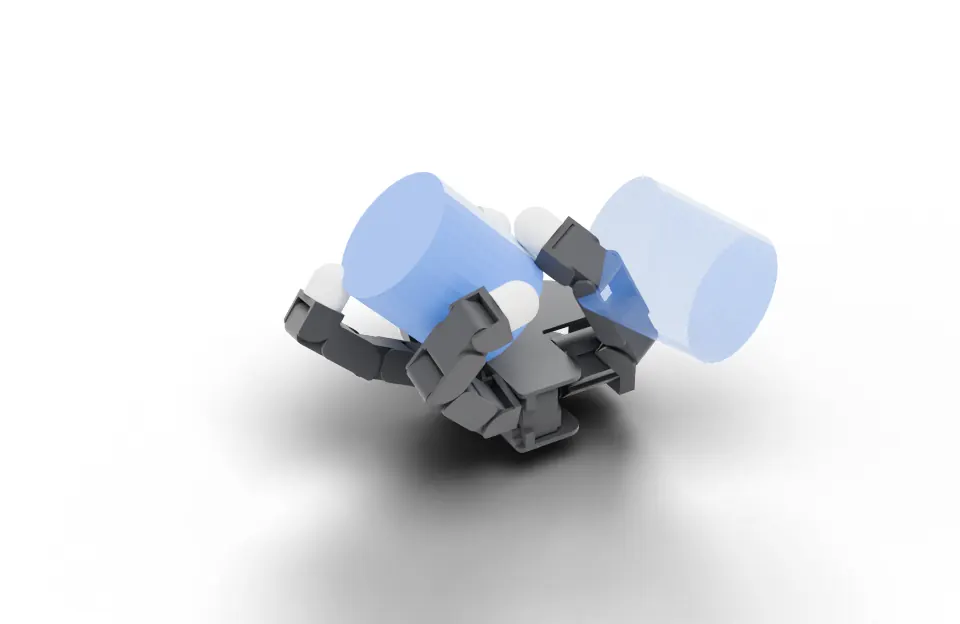<br><b>In-hand rotation</b> · Allegro<br><sub><code>InHand-Rotation-Allegro</code></sub></td>
    <td width="25%" align="center">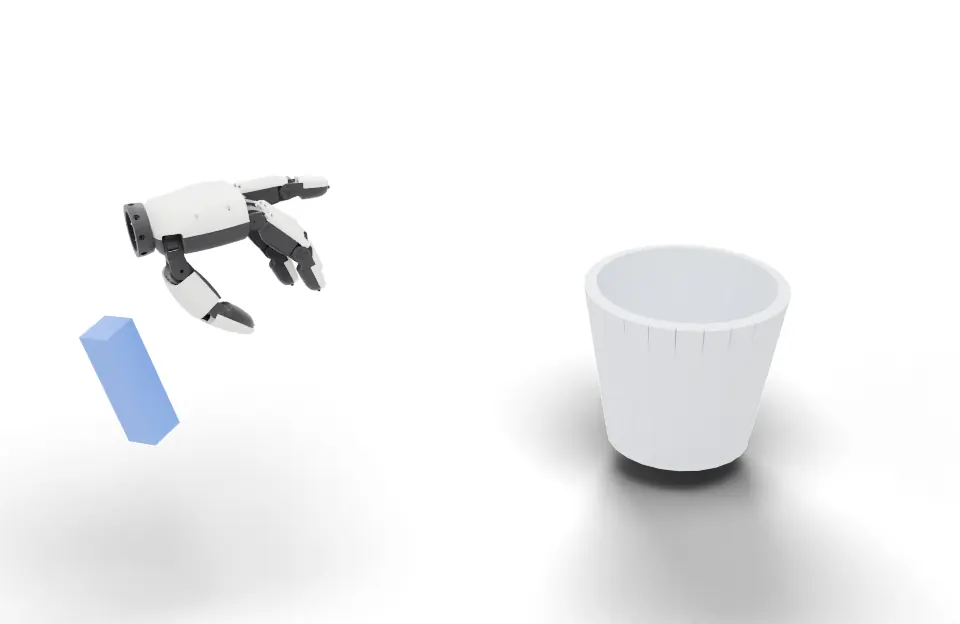<br><b>Grasp and throw</b> · XHand<br><sub><code>Grasp-Throw-XHand</code></sub></td>
    <td width="25%" align="center">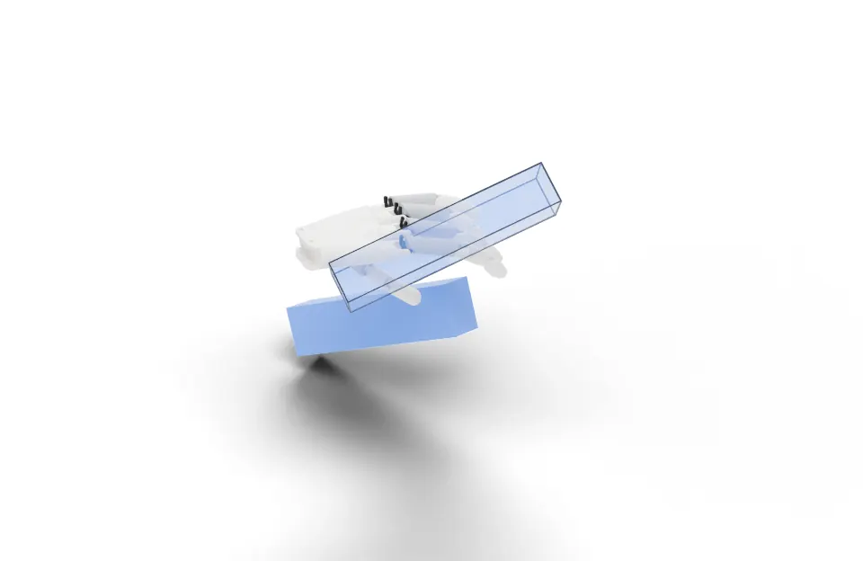<br><b>Reorientation</b> · Wuji<br><sub><code>Object-Reorientation-Wuji</code></sub></td>
  </tr>
  <tr>
    <td align="center">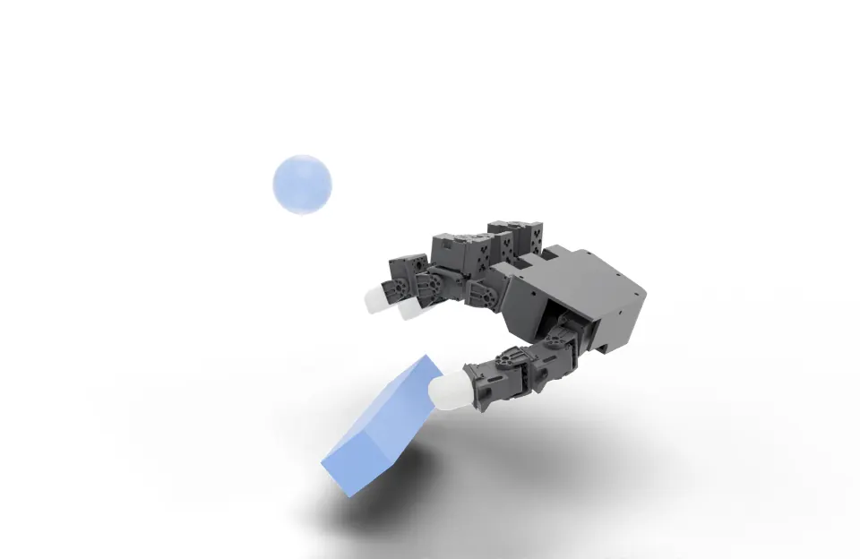<br><b>Regrasp</b> · LEAP<br><sub><code>Regrasp-LEAP</code></sub></td>
    <td align="center">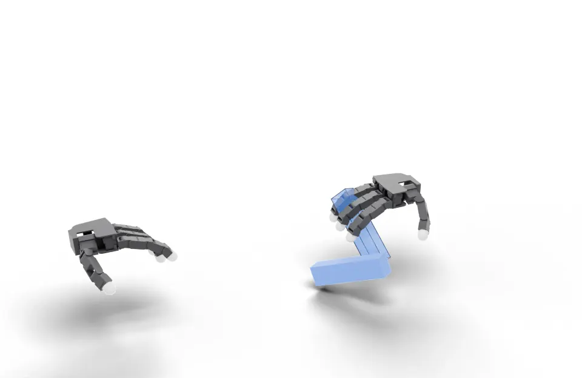<br><b>Two-hand handover</b> · Allegro<br><sub><code>DualHand-Reorientation-Allegro-TrackSlew</code></sub></td>
    <td align="center">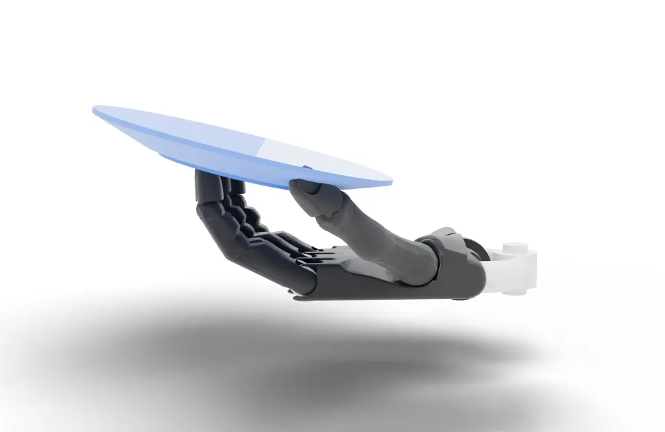<br><b>Plate spinning</b> · Shadow<br><sub><code>PlateSpin-Shadow</code></sub></td>
    <td align="center">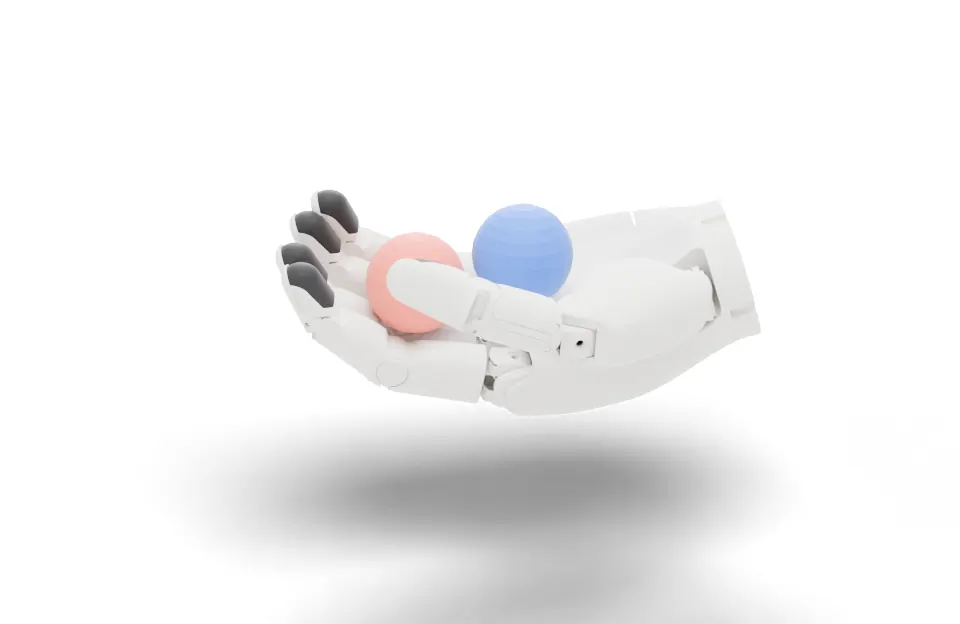<br><b>Baoding balls</b> · Sharpa<br><sub><code>Baoding-Sharpa-TiltThumb</code></sub></td>
  </tr>
</table>

### Juggling

<table>
  <tr>
    <td width="33%" align="center">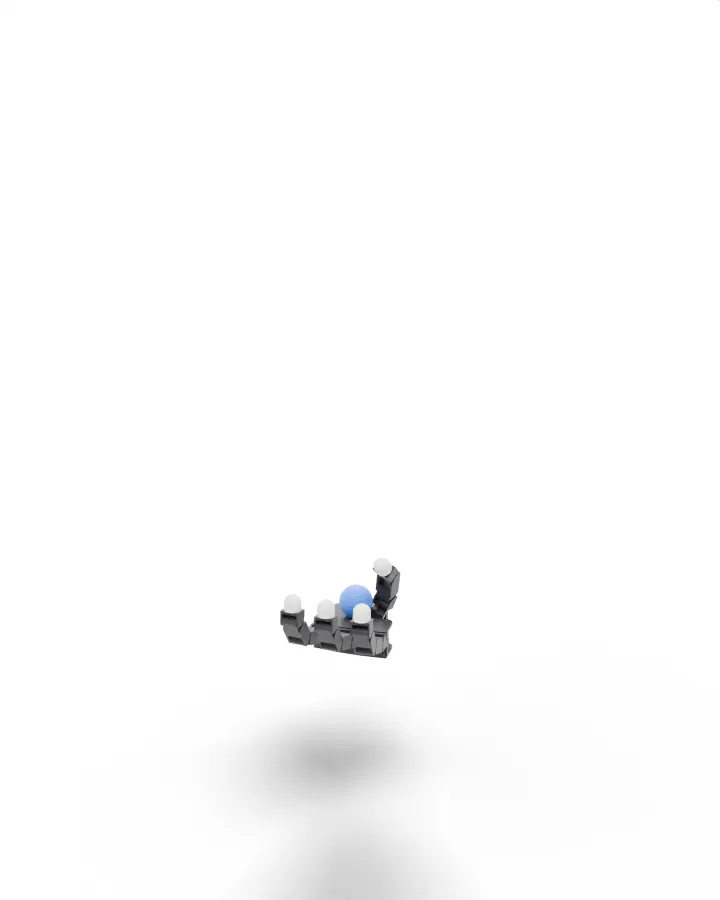<br><b>One ball</b> · Allegro<br><sub><code>Juggle1-OneHand-Allegro</code></sub></td>
    <td width="33%" align="center">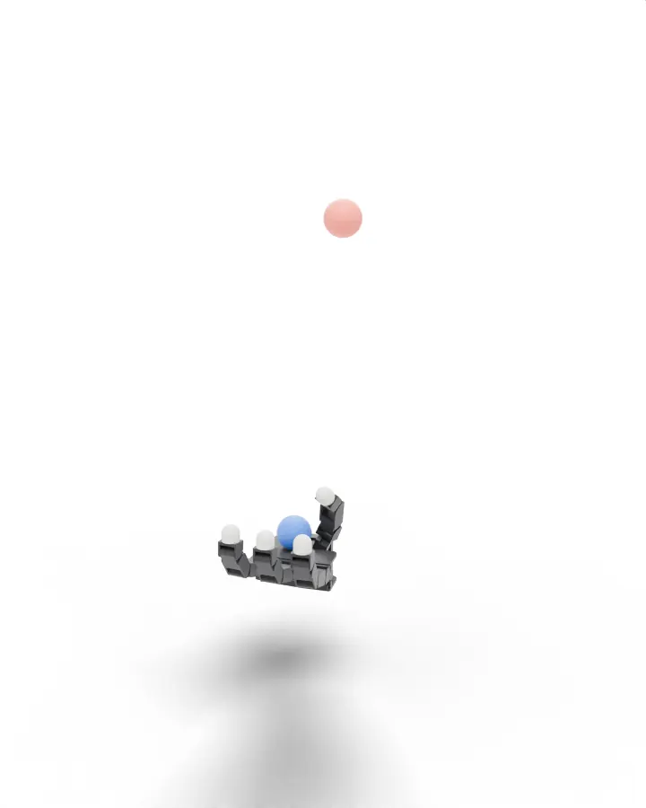<br><b>Two balls</b> · Allegro<br><sub><code>Juggle2-OneHand-Allegro-Entry6</code></sub></td>
    <td width="33%" align="center">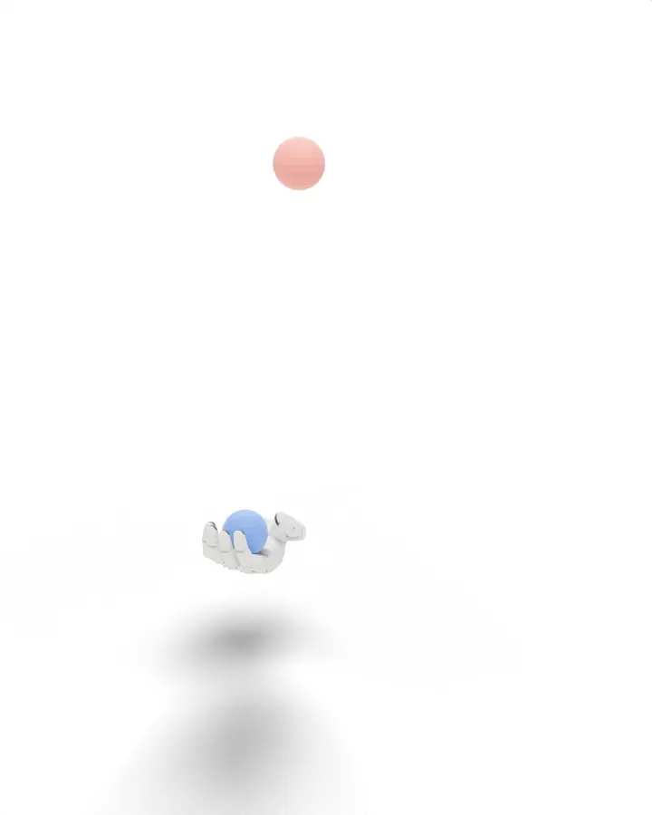<br><b>Two balls, whole hand</b> · Sharpa<br><sub><code>Juggle2-OneHand-Sharpa-Full</code></sub></td>
  </tr>
</table>

<table>
  <tr>
    <td width="20%" align="center">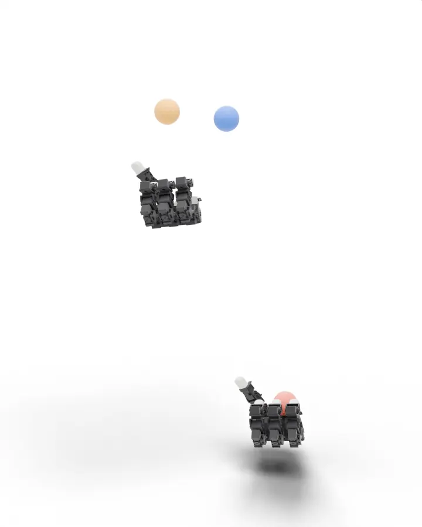<br><b>Cascade</b> · LEAP<br><sub><code>Juggle3-LEAP-Cascade-Residual</code></sub></td>
    <td width="20%" align="center">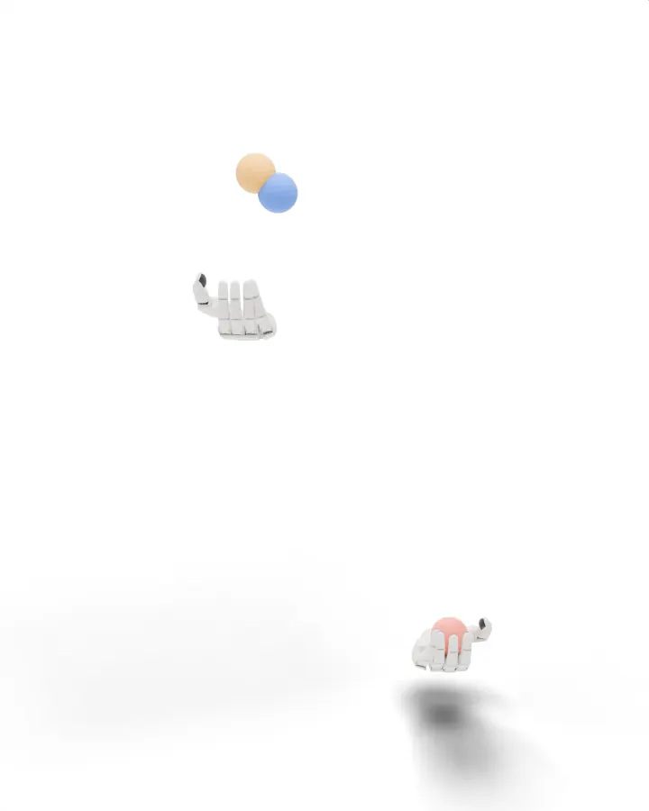<br><b>Tennis</b> · Sharpa<br><sub><code>Juggle3-Sharpa-Tennis</code></sub></td>
    <td width="20%" align="center">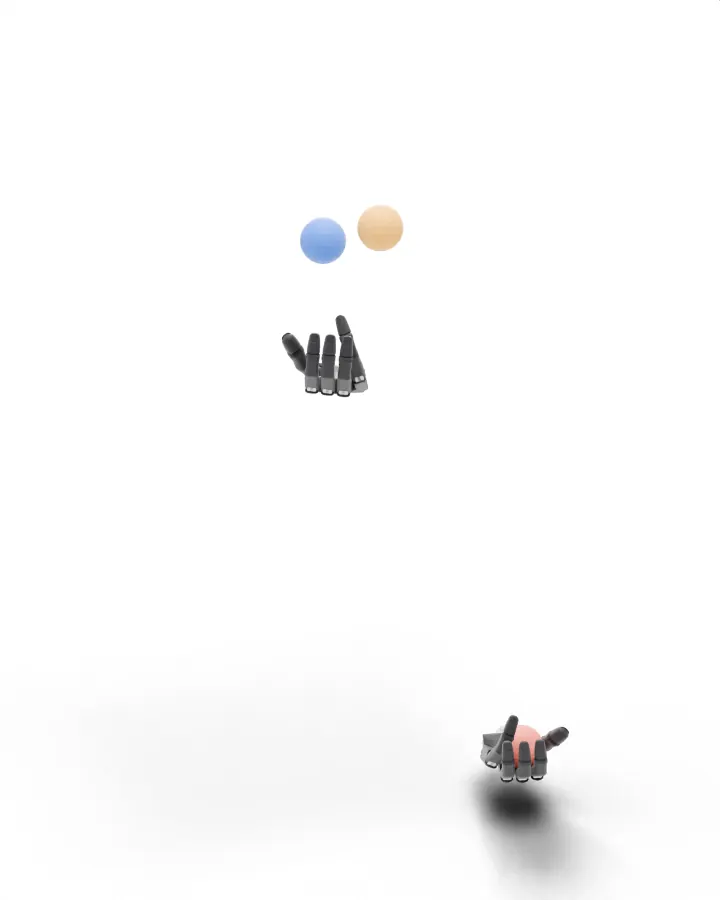<br><b>Half-shower</b> · Shadow<br><sub><code>Juggle3-Shadow-HalfShower</code></sub></td>
    <td width="20%" align="center">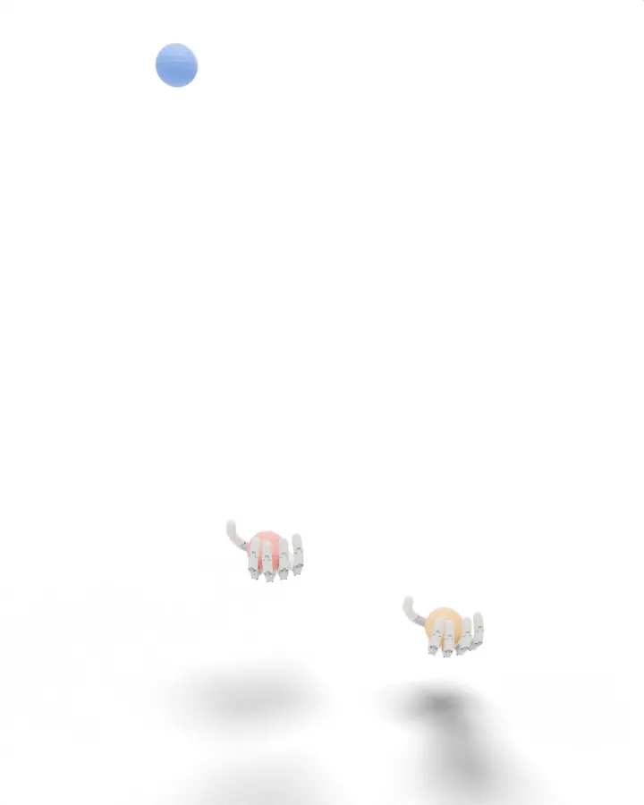<br><b>Box</b> · Wuji<br><sub><code>Juggle3-Wuji-Box</code></sub></td>
    <td width="20%" align="center">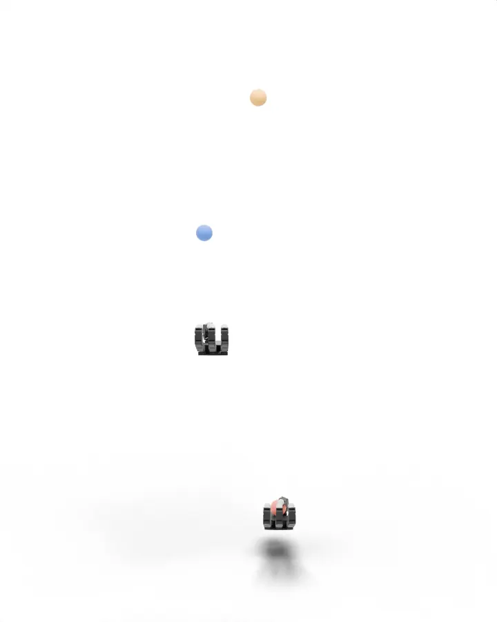<br><b>Shower</b> · Allegro<br><sub><code>Juggle3-Allegro-Shower</code></sub></td>
  </tr>
</table>

## Installation

```bash
git clone https://github.com/ruoyiqiao/mjlab_hand.git
cd mjlab_hand

# Install locked dependencies (Python 3.13 required)
uv sync --locked
```

## Quick Start

List the registered tasks, optionally filtered by a keyword:

```bash
uv run list-envs
uv run list-envs --keyword Juggle3
```

Train any task with `uv run train <task-id>`, for example:

```bash
uv run train Grasp-Allegro --env.scene.num-envs 2048
uv run train Grasp-Throw-XHand --env.scene.num-envs 2048
uv run train Juggle3-LEAP-Cascade-Residual --env.scene.num-envs 2048
uv run train PlateSpin-Shadow --env.scene.num-envs 2048
```

Useful flags: `--agent.seed`, `--env.scene.num-envs` and `--agent.max-iterations`. For `Grasp-*` and
`InHand-Rotation-*`, `--env.rewards.contact_explorer_reward.weight 0.0` disables the ContactExplorer rewards.

## Custom Objects

Override the default object and scale:

```bash
# Train Allegro Hand to grasp a hammer
uv run train-object Grasp-Allegro --object hammer --env.scene.num-envs 2048

# Train Allegro Hand for in-hand rotation with a scaled cylinder
uv run train-object InHand-Rotation-Allegro --object cylinder_medium --scale 0.8,0.8,0.8
```

Objects are loaded from ContactDB. Examples: `cube`, `cylinder_medium`, `ps_controller`, `mug`, `flashlight`, `pan`.

> [!NOTE]
> Not every object in this repository has been tested. Some objects may need additional tuning on mdp components and training hyperparameters, to learn successfully.

## Evaluation & Playback

### Interactive Visualization

```bash
uv run play-object Grasp-Shadow --checkpoint-file /path/to/model.pt
```

`play-object` wraps mjlab's `play` and works for every task; `--object` and `--scale` change the object of
`Grasp-*` and `InHand-Rotation-*`.

### Batch Evaluation

`eval-policy` evaluates grasping, in-hand rotation, throwing, reorientation, regrasping and the two-hand handover:

```bash
uv run eval-policy --task Grasp-Allegro --checkpoint /path/to/model.pt --output eval_metrics.json
```

It prints the success rate (grasping, and with Wilson 95% intervals for throwing, reorientation, regrasping and
the handover) or the average successes before a drop (in-hand rotation), and writes JSON when `--output` is given.

Juggling and the palm tasks have their own evaluation scripts:

```bash
# one or two balls: juggling time, full-length episodes, catches
uv run python tools/allegro4/eval_juggle.py Juggle2-OneHand-Allegro /path/to/model.pt out.json
# three balls: consecutive caught throws, failure causes, landing errors
uv run python tools/allegro4/eval_three_ball.py Juggle3-LEAP-Cascade-Residual out.json --checkpoint /path/to/model.pt
# plate spinning / Baoding balls: turns per episode in each direction, drops, fingertip support
uv run python tools/allegro4/palm_eval.py PlateSpin-Shadow /path/to/model.pt --out out.json
```

**WandB integration:**

```bash
uv run eval-policy --task InHand-Rotation-Allegro --wandb-run-path entity/project/run_id
```

## Acknowledgements

- Hand models: Allegro, LEAP and Shadow from [MuJoCo Menagerie](https://github.com/google-deepmind/mujoco_menagerie);
  Sharpa Wave from [Sharpa Robotics](https://github.com/sharpa-robotics/sharpa-urdf-usd-xml); XHand from
  [DexScrew](https://github.com/x-robotics-lab/dexscrew); Wuji from [Wuji Technology](https://github.com/wuji-technology/wuji-description).
- Object meshes: [ContactDB](https://contactdb.cc.gatech.edu/).
- Tasks: throwing, reorientation, regrasping and two-hand handover follow [DexPBT](https://arxiv.org/abs/2305.12127);
  three-ball juggling follows the controller structure of [Lee et al.](https://arxiv.org/abs/2608.26800).

We thank the authors for making their work available.

## Citation

If you find this project useful, please consider citing it:

```bibtex
@misc{qiao2026mjlabhand,
  title={mjlab\_hand: Dexterous Hand Tasks in mjlab},
  author={Qiao, Ruoyi},
  howpublished={\url{https://github.com/ruoyiqiao/mjlab_hand}},
  year={2026}
}

@article{liu2026contactexplorer,
  title={Contact Coverage-Guided Exploration for General-Purpose Dexterous Manipulation},
  author={Liu, Zixuan and Qiao, Ruoyi and Tie, Chenrui and Liu, Xuanwei and Lou, Yunfan and Gao, Chongkai and Xu, Zhixuan and Shao, Lin},
  journal={arXiv preprint arXiv:2603.10971},
  year={2026}
}

@article{zakka2026mjlab,
  title={mjlab: A Lightweight Framework for GPU-Accelerated Robot Learning},
  author={Zakka, Kevin and Liao, Qiayuan and Yi, Brent and Lay, Louis Le and Sreenath, Koushil and Abbeel, Pieter},
  journal={arXiv preprint arXiv:2601.22074},
  year={2026}
}

@inproceedings{petrenko2023dexpbt,
  title={DexPBT: Scaling up Dexterous Manipulation for Hand-Arm Systems with Population Based Training},
  author={Petrenko, Aleksei and Allshire, Arthur and State, Gavriel and Handa, Ankur and Makoviychuk, Viktor},
  booktitle={Robotics: Science and Systems (RSS)},
  year={2023}
}

@article{lee2026rapid,
  title={Rapid On-Robot Learning for Dynamic Manipulation Skills: Robot Juggling},
  author={Lee, Taeyoon and Wang, Chunpeng and Atkeson, Christopher G. and Rizzi, Alfred A. and Rojas, Nicolas},
  journal={arXiv preprint arXiv:2608.26800},
  year={2026}
}
```

## License

| Component | License | Commercial use |
|---|---|---|
| Original mjlab_hand code | [Apache-2.0](LICENSE) | Permitted |
| Hand models (Allegro, LEAP, Shadow, Sharpa, XHand, Wuji) | BSD-2-Clause, MIT or Apache-2.0, per hand | Permitted |
| ContactDB object meshes (`asset/contactdb`) | ContactDB terms | Not permitted |

Third-party components keep their upstream licenses; see [NOTICE](NOTICE) and the license file next to each
component.
